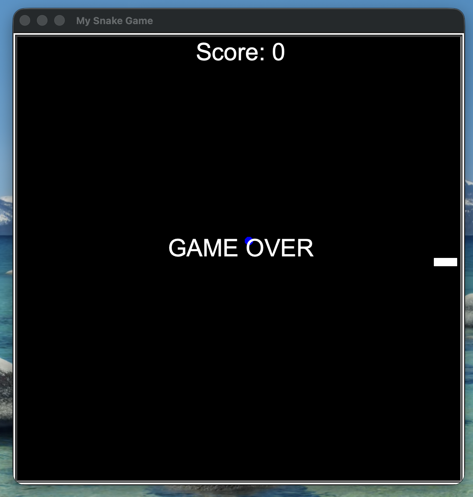

🐍 Snake Game

A simple and fun Snake Game built as a beginner-friendly project. Control the snake, eat the food, grow longer, and try to achieve the highest score without hitting the walls or yourself.

🎮 Features

🐍 Classic Snake gameplay

🍎 Randomly generated food

📈 Score tracking

💥 Game-over detection

🎨 Simple and clean user interface

⚡ Smooth gameplay

🕹️ How to Play

Start the game.

Use the Arrow Keys to control the snake.

Eat the food to increase your score and snake length.

Avoid hitting:

The walls

The snake's own body

The game ends when the snake collides with an obstacle.

Restart the game and try to beat your previous score!

Controls
Key	Action
⬆️ Arrow Up	Move Up
⬇️ Arrow Down	Move Down
⬅️ Arrow Left	Move Left
➡️ Arrow Right	Move Right
🔄 Restart	Restart the Game
🛠️ Technologies Used

Python
Turtle

📂 Project Structure
snake-game/
│
├── food.py
|__ snakegame.py
├── score.py
├── snake.py
└── README.md

The file structure may vary depending on your implementation.

🚀 Getting Started
1. Clone the repository
git clone https://github.com/abhi-179/Python_Preparation/snake-game.git

2. Navigate to the project
cd snake_game

3. Run the game

python3 snakegame.py

📸 Screenshots

Add screenshots of your game here:

🤝 Contributing

Contributions are welcome!

Fork the repository.

Create a new branch:

git checkout -b feature/new-feature

Make your changes.

Commit your changes:

git commit -m "Add new feature"

Push the branch:

git push origin feature/new-feature

Open a Pull Request.

📄 License

This project is open source and available under the MIT License.

👨‍💻 Author

Your Name

GitHub: https://github.com/abhi-179/

⭐ If you enjoyed this project, consider giving the repository a star!